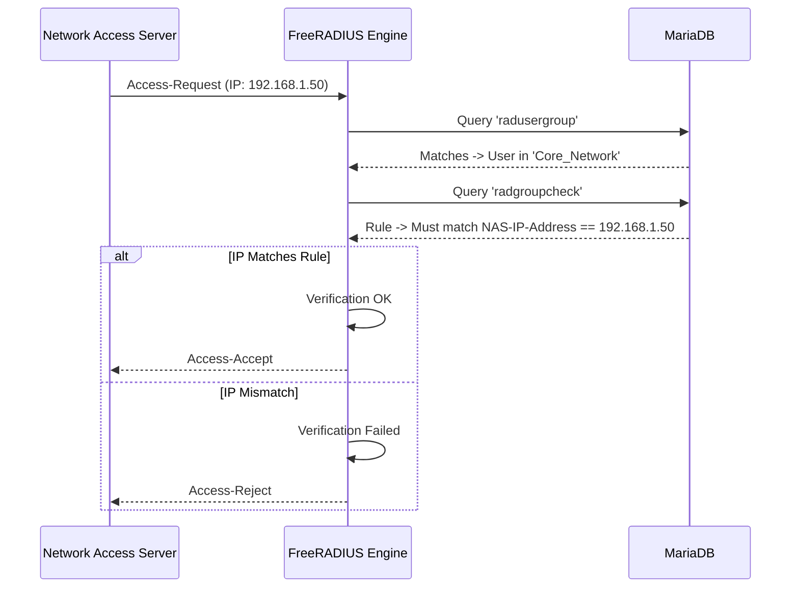

# NAS Provisioning & Huntgroups

> **Status:** Refreshed for v1.3.0. Endpoint of record is `/nas` and
> `/nas-categories`. For the AI-agent runnable version see
> [`docs/modules/nas-categories.md`](modules/nas-categories.md) and the
> deployment examples in [`docs/simulation/01-basic-access-request.md`](simulation/01-basic-access-request.md)
> (Phase 3 — placeholder).

ZeroRadius leverages **Huntgroups** and **NAS-IP-Address** anchoring to cleanly
isolate what hardware profiles a user can authenticate against. This prevents a
user provisioned for "Branch Office WiFi" from successfully logging into the
"Core Data Center Routers".

## 1. Creating a NAS (Network Access Server)

A NAS represents any hardware device (Router, Switch, Wireless Controller)
configured to ask FreeRADIUS for AAA services.

1. Navigate to the **NAS Devices** module in ZeroRadius (`/nas` in the UI).
2. Provide the **IP Address** (IPv4 or CIDR), **RADIUS Secret**, and
   optionally **shortname** / **description**.
3. *Optional:* assign a **NAS Category** (Core Routers, WiFi Controllers,
   Branch Switches) for bulk operations and privilege mapping. See
   [`docs/modules/nas-categories.md`](modules/nas-categories.md).
4. *(v1.3.0+)* The `validate_nasname` validator rejects hostnames; only IPs
   and CIDRs are accepted. This is part of the **nas-category-policy-hardening**
   change.

### Hostname rejection rationale

Allowing `nasname = "my-switch.local"` produces ambiguous RADIUS sources
(`NAS-IP-Address` is the principal anchor for Access Policies). If you
absolutely need a logical name, register the **shortname** in the dictionary
field and let the IP do the work.

### Bulk import (CSV)

To onboard many devices at once (for example every AP of several branches),
admins and superadmins can use **Bulk import (CSV)** on the NAS Devices page,
or call `POST /nas/bulk/csv` directly. **Download template** (`GET
/nas/bulk/template`) gives a ready-to-edit file.

| Column | Required | Notes |
|---|---|---|
| `nasname` | yes | IP, CIDR or hostname, same rules as the single NAS form |
| `secret` | yes | 32 to 60 characters |
| `shortname` | no | Up to 32 characters |
| `category` | no | Name of an existing NAS category. When empty, the optional **Default category** (`default_category_id`) is used |
| `type` | no | Defaults to `other` for new rows |
| `description` | no | Up to 200 characters |

Rules:

- Each row is validated on its own. Invalid rows are listed in the result with
  their data row number (1 = first row after the header) and are skipped; the
  valid rows are saved together.
- A `nasname` that already exists once is **updated** (secret plus any
  non-empty optional cell; empty cells keep the current value).
- A `nasname` that already exists on several rows, or that appears more than
  once in the file, is reported as an error (later repetitions only).
- Unknown category names are errors. Files over 1 MB or 5000 data rows are
  rejected as a whole.
- Tick **Validate only (dry run)** (`dry_run=true`) to see how many rows would
  be created or updated and which rows fail, without writing anything.
- Secrets never appear in the result or in the audit log; the import writes one
  `BULK_CSV` audit entry with the counts. The import does not restart
  FreeRADIUS.

## 2. Using Huntgroups for Regional Segmentation

In FreeRADIUS, a Huntgroup allows you to bundle several NAS devices under a
single localized umbrella. ZeroRadius expresses this using the `radgroupcheck`
tables — there is no need to manually edit FreeRADIUS huntgroup files.

### Architecture Flow



### Steps to Segment a User

By creating a policy that maps to a `NAS-IP-Address`, the backend forces an
automatic rejection if the credential is used on any device failing the rule.

1. Head to **Access Policies** (`/access-policies`).
2. Select your Target Group.
3. Add a check condition: `NAS-IP-Address == <Your NAS IP>`.
4. *(or)* Use **network segments** for CIDR-wide targeting.

For the full targeting + precedence chain, see
[`docs/modules/access-policies.md`](modules/access-policies.md#4-precedence--priority--fallback-chain).

> **Enforcement semantics (closes
> [issue #92](https://github.com/alexandervazquez98/ZeroRadius/issues/92)):**
> A `radgroupcheck` row whose `NAS-IP-Address` value does not match the
> incoming request MUST cause `Access-Reject`. The enforcement is
> performed by the explicit unlang policy at
> [`radius/policy.d/nas_huntgroup_enforcement`](../radius/policy.d/nas_huntgroup_enforcement),
> wired into the `authorize` section of
> [`radius/default.conf`](../radius/default.conf) after the second `-sql`
> pass. The policy is independent of `rlm_sql` because `rlm_sql` only
> loads check items with `==` semantics — it does not return `fail` on a
> mismatch. The distinct `Reply-Message`
> `"Huntgroup check failed: NAS-IP-Address does not match group rule"`
> distinguishes the reject path in FreeRADIUS debug logs from the
> `nas_based_authorization` reject (which uses
> `"Access denied: NAS not authorized for this user"`).

## 3. Vendor notes

### Password type per authentication protocol

The password type chosen for a RADIUS user decides which NAS can
authenticate it. The backend hashes `MD5-Password` and `NT-Password` on
write; no password value is ever returned by the API.

| Password type | PAP | MS-CHAPv2 | Storage |
|---|---|---|---|
| `Cleartext-Password` | yes | yes | cleartext |
| `MD5-Password` | yes | **no** | unsalted MD5 |
| `NT-Password` | yes | yes | unsalted MD4 of UTF-16LE (#96) |

`NT-Password` covers PAP devices (Cisco IOS, Moxa) and MS-CHAPv2 devices
(MikroTik) without cleartext storage. It is unsalted and
password-equivalent for MS-CHAP (pass-the-hash), so treat the `radcheck`
table as sensitive anyway. A stored hash cannot be converted to another
type: changing the type requires entering the password again.

To check MS-CHAP against a user by hand (from the radius container or a
host with `freeradius-utils`; `radtest -t mschap` sends MS-CHAP v1, the
same stored value serves v2, which the router exercises):

```bash
radtest -t mschap <user> '<password>' 127.0.0.1 0 <shared-secret>
```

### MikroTik RouterOS

- `dictionary.mikrotik` ships by default (#99), so groups can reply
  `Mikrotik-Group := full` (or `write` / `read`).
- RouterOS management logins use **MS-CHAPv2**: the user must be
  `NT-Password` or `Cleartext-Password` (`MD5-Password` is rejected with
  `MS-CHAP-Error ... E=691`).
- RouterOS 7.15+ requires a `Message-Authenticator` on replies by default
  (`require-message-auth`); ZeroRadius signs replies to signed requests
  (#100).
- Router side:

  ```
  /radius add service=login address=<zeroradius-ip> secret=<shared-secret> src-address=<router-ip>
  /user aaa set use-radius=yes default-group=read
  ```

  `default-group` applies when the reply carries no `Mikrotik-Group`, so
  keep it least-privileged.

### Moxa

- Uses PAP and standard attributes only; no vendor dictionary is needed.
- Access level comes from `Service-Type`: `Administrative-User` for
  admin, `Login-User` for read-only.
- Observed in the lab: the web GUI silently truncates the shared key to
  32 characters, so use a secret of at most 32 characters.

### Cisco IOS

- With PAP logins (the usual IOS setup) any password type works; CHAP
  would need `Cleartext-Password`.
- Privilege level comes from `Cisco-AVPair = "shell:priv-lvl=N"`
  (`dictionary.cisco` ships by default, #76).

## 4. Cross-references

- **API:** [`/nas` and `/nas-categories`](api-reference.md)
- **NAS Categories module:** [`docs/modules/nas-categories.md`](modules/nas-categories.md)
- **Access Policies module:** [`docs/modules/access-policies.md`](modules/access-policies.md)
- **JIT Break-Glass (per-NAS):** [`docs/03-jit-break-glass.md`](03-jit-break-glass.md)
- **Live log viewer (post-auth trail):** [`docs/04-live-log-viewer.md`](04-live-log-viewer.md)
